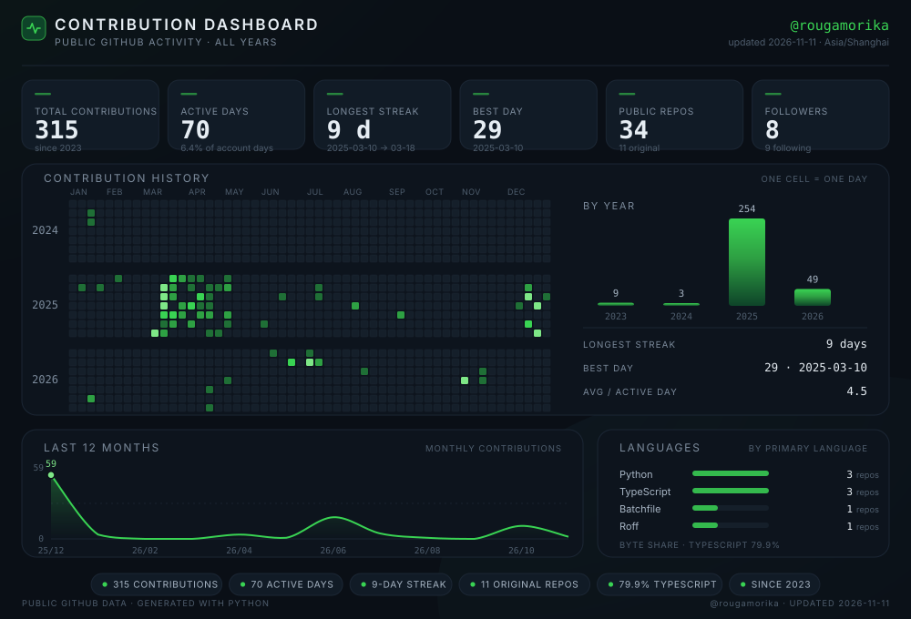

  
 

## 关于我 · About Me

我是 Fernandez Rougamo Zhou，GitHub 上是 [@rougamorika](https://github.com/rougamorika)，上海电力大学新能源科学与工程专业 2023 级本科生（2023.9 – 2027.6）。研究兴趣是信号处理、机械臂和风能技术，以及机器学习在这些方向上的应用。

目前的工作集中在垂直轴风力机的气动与气动噪声数值研究上，也在折腾一些小项目和竞赛。现在主要在打基础：信号与系统、电路、控制都在学，数学笔记也在慢慢整理。比起把知识背下来，我更在意能不能把它讲清楚——博客「肉夹馍旗舰店」多少就是用来检验这件事的。

技术之外弹贝斯，听 disco 和摇滚，看动画；语言上中英文熟练，日语约 N4、德语约 B1，法语和西班牙语刚起步。

*Undergraduate in New Energy Science & Engineering at Shanghai University of Electric Power (2023–2027). I work around signal processing, robotics and wind-energy systems, and the machine learning that ties them together — currently on the aerodynamics and aeroacoustics of vertical-axis wind turbines. I write maths notes and experiments at 「肉夹馍旗舰店」, because explaining something clearly is the only proof that I understand it.*

## 研究兴趣 · Research Interests

| 方向 · Area | 在做什么 · Focus |
|---|---|
| **信号处理 · Signal Processing** | 分析、变换与重建信号：从采样、滤波到系统响应。 |
| **机械臂 · Robotics** | 运动学、轨迹规划，以及把学习算法接到真实硬件上。 |
| **风能技术 · Wind Energy** | 风力机建模、功率预测与并网控制。 |
| **机器学习 · Machine Learning** | 把学习算法用在信号、机械臂和风电上：建模、预测与控制。 |

*Four threads that keep crossing: signals, manipulators, turbines, and the learning that ties them together.*

## 贡献面板 · Contribution Dashboard

数据每日由 GitHub Actions 从公开 API 重新生成 · refreshed daily

## 竞赛与科研 · Awards & Research

**论文 · Paper**

> **Numerical study of the aerodynamic and acoustic benefits of novel arc-shaped trailing-edge serrations for vertical axis wind turbine** 
> Yujun Li, Li Xu, **Zhenyue Zhou**, Jingjing Cai, Bo Tang, Xiaojing Zhu 
> *International Journal of Green Energy*, 2026 · [Paper](https://www.tandfonline.com/eprint/XANSDUZHVAJ7GN8DPPIT/full?target=10.1080/15435075.2026.2737959)

**竞赛 · Competitions**

| 年份 · Year | 比赛 · Competition | 结果 · Result |
|---|---|---|
| 2026 | 睿抗机器人开发者大赛 · 智能配送与分拣赛题（全国总决赛 · 桌面组） | 三等奖 · 3rd Prize |
| 2026 | 睿抗机器人大赛 · 智能配送与分拣赛项（上海市赛区） | 二等奖 · 2nd Prize |
| 2025 | 睿抗机器人大赛 · 协作机械臂虚实结合挑战赛（上海市赛区） | 三等奖 · 3rd Prize |
| 2025 | 全国大学生数学建模竞赛 CUMCM（上海赛区） | 三等奖 · 3rd Prize |

*RAICOM robotics events and CUMCM, plus a 2026 paper on trailing-edge serrations for vertical-axis wind turbines.*

## 精选项目 · Selected Projects

| 代码 · Code | 书稿与索引 · Writing & Index |
|---|---|
| **[rougamorika.github.io](https://github.com/rougamorika/rougamorika.github.io)** `React · Vite · TypeScript` 「肉夹馍旗舰店」博客：KaTeX 数学渲染、文章关系思维导图、自定义播放器、动漫风主题。 | **[Mathbook-Draft-ver](https://github.com/rougamorika/Mathbook-Draft-ver)** `书稿 · 简体中文` 数学分析、线性代数与古典概率的思考书稿——不是传统习题集。 |
| **[New-Concept-Signals](https://github.com/rougamorika/New-Concept-Signals)** `Python` 用 Python 实现电子与信号概念的小型实验仓库。 | **[More on GitHub →](https://github.com/rougamorika?tab=repositories)** `33 repos · 10 originals` 其余是 fork、课程与工具镜像；完整列表见仓库页。 |

*The blog, a maths book draft, and a signal-experiment repo — the rest is in the repositories tab.*

## 技术栈 · Tech Stack

| 分组 · Group | 内容 · Stack |
|---|---|
| 语言 · Languages | `Python`（主）· `C` · `C++` · `TypeScript` |
| 排版与版本 · Typesetting & VCS | `LaTeX` · `Git` |
| 博客 · Blog | `React 18` · `Vite` |
| 方向相关 · Coursework | 信号与系统 · 电路 · 控制（在学）· 数值计算 / 建模（风电方向） |

主语言 Python；C / C++ 与 TypeScript 按需；排版用 LaTeX，版本管理用 Git；博客跑在 React + Vite 上。

*Python first; C/C++ and TypeScript when needed; LaTeX for typesetting, Git for versioning; the blog runs on React + Vite.*

## 最近在忙 · Now

- 学信号与系统、电路、控制，整理数学笔记（会陆续发在博客）。
- 垂直轴风力机气动 / 气动噪声的数值研究。
- 维护「肉夹馍旗舰店」，把数学推导、电子与信号小实验写成能读懂的文章。

*Currently: signals, circuits and control; VAWT aeroacoustics; and keeping 「肉夹馍旗舰店」 alive.*

## 联系我 · Get in Touch

| 渠道 · Channel | 地址 · Where |
|---|---|
| Email | [1824842213fernandez@gmail.com](mailto:1824842213fernandez@gmail.com) |
| GitHub | [@rougamorika](https://github.com/rougamorika) · 显示名 `Rougamo is just A Rougamo` |
| Blog | [rougamorika.github.io](https://rougamorika.github.io/) ·「肉夹馍旗舰店」 |

欢迎聊信号、风电、机器学习，或者 disco。

肉夹馍旗舰店 · still on the way

